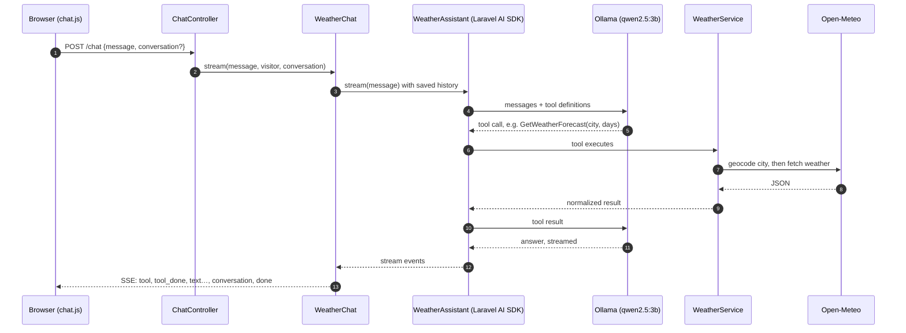

# Weather AI Agent

[](https://www.php.net)
[](https://laravel.com)
[](https://ollama.com)
[](LICENSE)

A weather chat assistant built with the **Laravel AI SDK**. A small language model running **locally on Ollama** (`qwen2.5:3b`) decides which *tool* to call, the tools fetch live data from **Open-Meteo**, and the answer streams into a Bootstrap chat page word by word. No cloud LLM and no API keys.

Ask things like:

- *"What is the weather in Ahmedabad right now?"* → current conditions
- *"Will it rain in London tomorrow?"* → daily forecast
- *"Is it warmer in Mumbai or Paris?"* → side-by-side comparison, computed in PHP

## Highlights

- **Tool calling with a 3B model.** Three tools with schemas and descriptions tuned so a small local model picks the right one (see [limitations](#known-limitations) for how reliably).
- **The model never does the maths.** City comparisons are computed in PHP (`WeatherComparator`), including ties and missing values, and returned with a ready-made summary sentence. The model only has to relay it.
- **Streaming UI.** Server-Sent Events over `fetch`, with live "Checking current weather in London…" tool indicators, a Stop button, and friendly errors.
- **Saved conversations without a login.** Each browser owns its conversations through a hashed cookie token; ownership is enforced on every read, continue and delete.
- **Resilient external calls.** Timeouts, retries on transient failures, unknown cities, partial or `null` API fields and unreachable servers are handled, logged, and turned into short messages the model can relay.
- **Thoroughly tested, offline.** 158 PHP tests plus 17 JavaScript tests, with every external call mocked (11 more are opt-in live tests). Line coverage of `app/` is about 98.8%, and the tests were checked by deliberately breaking the code in 17 places (all caught).

## How it works



### The tools

| Tool | Use it for | Input |
|---|---|---|
| `GetCurrentWeather` | Conditions right now in one city | `city`, optional `country_code` |
| `GetWeatherForecast` | Tomorrow, this week, "will it rain", highs and lows | `city`, optional `country_code`, `days` 1–7 (default 2) |
| `CompareCitiesWeather` | Comparing 2–5 cities right now | `cities`: `["London", "Paris, FR"]` |

The tool name the model sees is the class name. Tool descriptions and the agent's instructions (`app/Ai/Agents/WeatherAssistant.php`) spell out when to use each one.

## Requirements

- PHP 8.3+ with the `curl`, `mbstring`, `openssl`, `fileinfo` and `pdo_sqlite` extensions, and [Composer](https://getcomposer.org)
- [Ollama](https://ollama.com) with the model pulled: `ollama pull qwen2.5:3b`
- A browser with internet access (Bootstrap is loaded from a CDN)
- Node.js 22+ only if you want to run the JavaScript tests. The app itself needs no npm build.

## Quick start

```sh
git clone <your-repository-url> weather-ai-agent
cd weather-ai-agent

composer install
cp .env.example .env          # Windows PowerShell: Copy-Item .env.example .env
php artisan key:generate
touch database/database.sqlite   # Windows PowerShell: New-Item database/database.sqlite -ItemType File
php artisan migrate

ollama pull qwen2.5:3b        # once; make sure Ollama is running
php artisan serve
```

Open <http://localhost:8000>. If Ollama runs on another machine, set `OLLAMA_URL` in `.env` to that server's address.

**WAMP / Apache:** put the project in `www`, point a virtual host at the `public/` folder, and make sure `.env` and `database/database.sqlite` are writable by PHP. `php artisan serve` works too.

## Configuration

All settings live in `.env` (see `.env.example`).

| Variable | Default | Purpose |
|---|---|---|
| `OLLAMA_URL` | `http://localhost:11434` | Ollama server address |
| `OLLAMA_MODEL` | `qwen2.5:3b` | Model used by the agent |
| `OLLAMA_API_KEY` | *(empty)* | Only for secured Ollama servers |
| `OPEN_METEO_TIMEOUT` | `10` | Seconds before an Open-Meteo request is abandoned |
| `OPEN_METEO_GEOCODING_URL`, `OPEN_METEO_FORECAST_URL` | public Open-Meteo endpoints | Override to use a mirror |
| `AI_GENERATE_CONVERSATION_TITLES` | `false` | `true` = the model writes titles (an extra slow model call); `false` = first message, truncated |
| `DB_CONNECTION` | `sqlite` | See [limitations](#known-limitations) |

Limits you can change in code: forecast days (`GetWeatherForecast::MAX_DAYS`), cities per comparison (`CompareCitiesWeather::MAX_CITIES`), messages replayed as history (`WeatherAssistant::HISTORY_MESSAGES`), agent timeout (`WeatherAssistant::TIMEOUT_SECONDS`), message length (`ChatMessageRequest::MAX_LENGTH`).

## Project structure

```
app/
├── Ai/
│   ├── Agents/WeatherAssistant.php        instructions, tools, history window, timeout
│   └── Tools/                             GetCurrentWeather, GetWeatherForecast, CompareCitiesWeather
│       └── Concerns/InteractsWithOpenMeteo.php   shared schema, validation, error + log handling
├── Services/
│   ├── OpenMeteo/                         OpenMeteoClient (HTTP), WeatherCode (WMO codes)
│   ├── Weather/                           WeatherService (logic), WeatherComparator (maths)
│   └── Chat/                              WeatherChat (SDK events → UI events), ChatVisitors, ConversationHistory
├── Http/                                  ChatController (thin), ChatMessageRequest
└── Models/ChatVisitor.php                 anonymous browser identity
public/js/                                 chat-core.js (pure helpers), chat.js (DOM + networking)
resources/views/chat.blade.php             the chat page
tests/                                     Feature, Unit and js tests
```

## Design decisions

- **Tools are thin adapters; services hold the logic.** Tools validate input, call `WeatherService`, and turn *expected* failures into messages. Unexpected exceptions propagate on purpose so the SDK reports them and bugs stay visible.
- **Comparison is deterministic.** A 3B model is unreliable at arithmetic and at juggling several tool results, so one tool fetches every city and `WeatherComparator` does the ranking.
- **Forecast days are capped at 7** (Open-Meteo allows 16). Long forecasts make a small model slow, so the cap trades range for speed.
- **Conversations use the SDK's own storage.** The agent uses `RemembersConversations`; the app only adds an owner (`ChatVisitor`) and replays the last 10 messages to keep the small model fast.
- **Guest identity is a random token in an encrypted, HTTP-only cookie.** Only its SHA-256 hash is stored.
- **The browser never sees raw tool payloads, internal ids or server addresses.** `WeatherChat` converts SDK events into six small event types.

## Testing

```sh
composer test        # PHP: 158 tests, all external calls mocked (no Ollama, no internet)
composer test:js     # JavaScript: 17 tests with Node's built-in runner (no packages)
vendor/bin/pint --test app tests routes database    # code style
```

What is covered: the three tools (success, unknown city, timeouts, HTTP 4xx/5xx, malformed and `null` fields, invalid arguments), the exact tool schemas Ollama receives, the agent's tool loop with a faked model, the streaming endpoint and its events, conversation storage and ownership, cookie security, rate limiting, XSS escaping, and the SSE parser (split at every possible point).

**Live tests (optional).** Mocks cannot show which tool the real model picks, so a separate group asks your Ollama server 11 questions and checks the tool called. They are skipped by default and take several minutes:

```sh
OLLAMA_LIVE_TESTS=true composer test -- --group=ollama          # macOS / Linux / Git Bash
```

```powershell
$env:OLLAMA_LIVE_TESTS='true'; composer test -- --group=ollama  # Windows PowerShell
```

> **Windows + Xdebug:** with Xdebug in `develop` mode, PHP can crash (segfault) when an HTTP connection exception is thrown. `composer test` turns Xdebug off for the run; if you call `vendor/bin/phpunit` directly, set `XDEBUG_MODE=off` first.

CI (`.github/workflows/tests.yml`) runs Pint, the PHP suite and the JavaScript tests on every push and pull request.

## Performance

Indicative timings with `qwen2.5:3b` on a LAN Ollama server (the model dominates; your hardware will differ). The first request after Ollama starts is slower while the model loads.

| Question type | Typical time |
|---|---|
| Current weather | 12–26 s |
| Tomorrow's forecast | 17–21 s |
| Comparing 2–3 cities | 23–48 s |
| A week's forecast | 75–100 s |

Text streams as soon as the model starts answering, so the page is not frozen while it works.

## Security notes

- CSRF/origin protection on the chat endpoint, rate limit of 20 requests per minute, messages limited to 1,000 characters.
- Model output is HTML-escaped before display; only `**bold**` becomes markup.
- Conversations are scoped to the visitor on every access (a different browser gets a 404).
- No API keys in frontend code. Errors shown to users are generic; details go to the log (`storage/logs`).

## Known limitations

- **The small model is not always right.** Even at temperature 0, qwen2.5:3b occasionally picks the wrong tool and can then invent a value (seen once in six runs of one comparison question). A larger model (`OLLAMA_MODEL=qwen2.5:7b`) should help; this is not measured here.
- **Slow long answers.** A week-long forecast takes 75–100 s on the author's setup.
- **No login.** Clearing cookies or switching browser loses access to old conversations, and old guests are never cleaned up.
- **Stop is client-side.** The button ends the stream in the browser; the server stops when it next tries to write.
- **History grows each turn** (a window of 10 messages is replayed), so long conversations get slower.
- **Only SQLite is tested.** The migrations are standard Laravel, but MySQL has not been run.
- **Bootstrap comes from a CDN**, so the page needs internet access in the browser.
- Metric units and English place names only.

## Ideas for later

Authentication and per-user history, more tools (air quality, historical weather), vendoring the front-end assets, cancelling server-side generation, and a repeat-run mode for the live tests to measure tool-selection accuracy.

## Credits

[Laravel](https://laravel.com) and the [Laravel AI SDK](https://github.com/laravel/ai), [Ollama](https://ollama.com) and the [Qwen2.5](https://qwenlm.github.io) models, weather data from [Open-Meteo](https://open-meteo.com) (free for non-commercial use, no key; see their [terms](https://open-meteo.com/en/terms)), [Bootstrap](https://getbootstrap.com).

## License

Released under the [MIT License](LICENSE).
